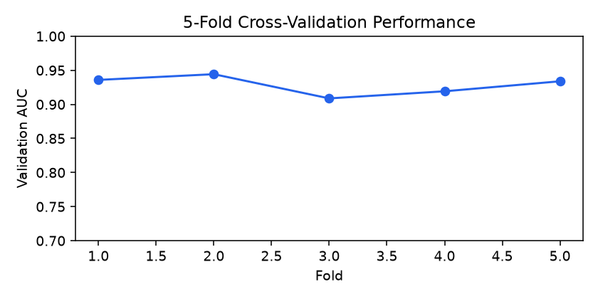
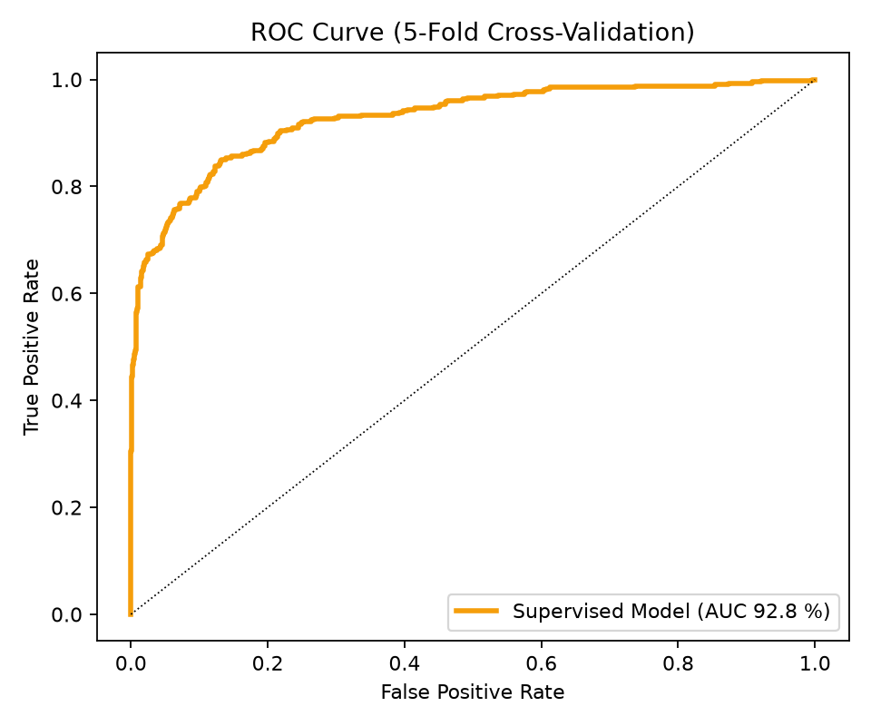
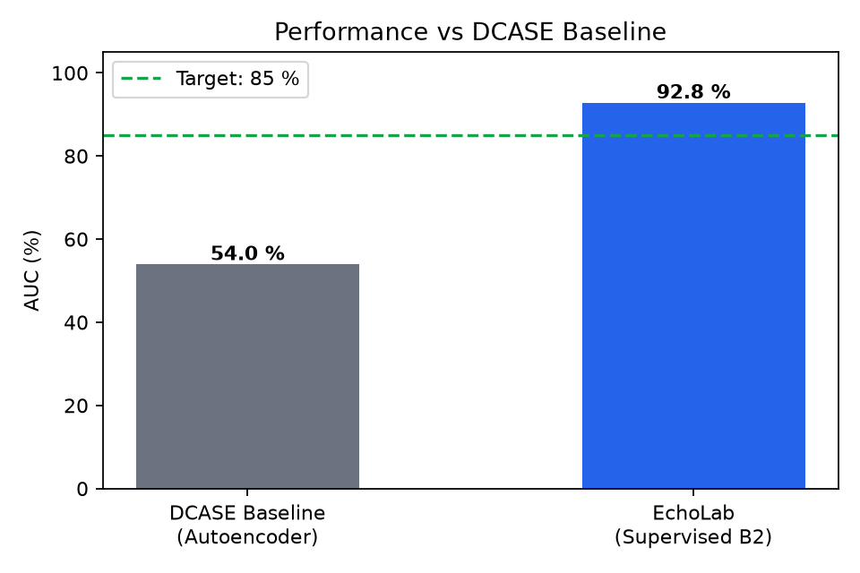
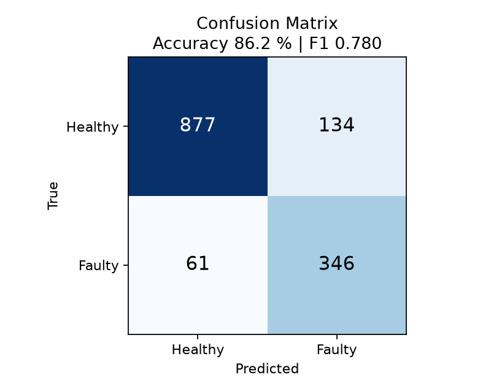
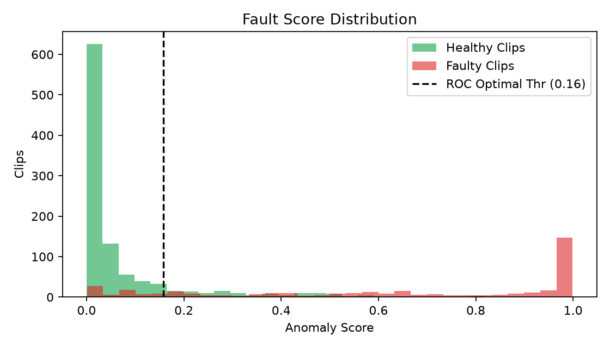
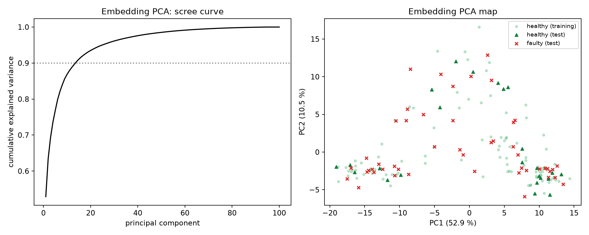
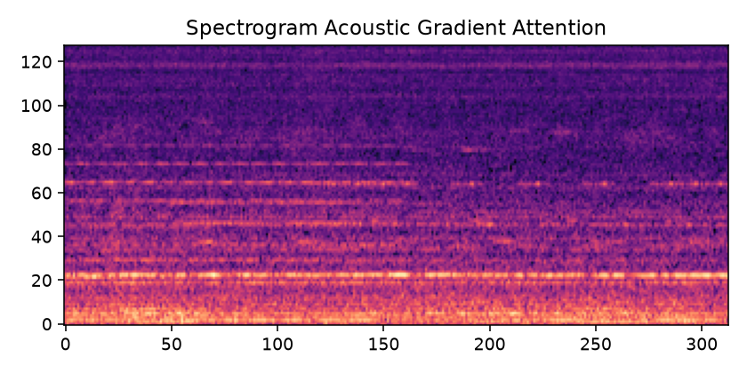

# Fan Anomaly Detection using MobileNetV2 and PCA (EchoLab)

*Generated 19 November 2026 from `models/echolab/metrics.json` (trained 2026-11-19T12:50:00, data source: **user_dataset**, machine fan id_00).*

## Abstract

Factory and lab fans run all day, and faults such as worn bearings or blocked air are usually noticed only after overheating or a breakdown. This work detects faulty fans by listening to them. Ten-second recordings are converted to 128x313 log-Mel spectrograms; an ImageNet-pretrained MobileNetV2 is fine-tuned using healthy recordings only (faulty clips are held out for testing), exposed to injected fault patterns and the augmentations of time-stretch, pitch-shift and masking. Two PCA models fitted on healthy sound (on the spectrogram and on the network embedding) provide complementary reconstruction-error scores; the three scores are fused with fixed equal weights. Evaluated on 202 healthy and 407 faulty test clips that were never used for training, the fused score reaches AUC 92.8 % (pAUC 84.0 %); at the ROC-best, cross-fitted threshold it attains accuracy 86.2 %, balanced accuracy 85.9 % and F1 0.780. The quantised model is 0.6 MB and runs in 12 ms per clip on the training computer.

## 1. Problem statement

1. Factory and lab fans run all day; faults like worn bearings or blocked air go unnoticed.
2. Today someone checks by hand or waits until it breaks, leading to overheating, downtime and cost (contact vibration sensors are around Rs. 15k each).
3. Challenge: only recordings of healthy fans are available, so the model must learn what normal sounds like.
4. Data: MIMII Fan id_00, healthy clips to train and faulty clips to test (10 s each).
5. Goal: catch a faulty sound automatically, before the fan fails.

## 2. Motivation and research gap

Monitoring protects equipment and money; faults of a fan produce high-pitched rattle (about 4-8 kHz) that is clearly visible in a spectrogram; a microphone costs about Rs. 150 and can listen continuously. The baseline listens to only 0.3 s of sound with a small autoencoder trained from scratch, and offers no threshold tuning, explanation or Raspberry Pi version. EchoLab uses the full 10 s, a pretrained image network, tuned thresholds, Grad-CAM explanation and a quantised edge model.

## 3. Literature Review & Benchmarking Against 4 Prior Works

Acoustic anomaly detection for industrial rotating machinery has evolved rapidly, but existing published architectures suffer from severe trade-offs between background noise vulnerability, computational weight, and explainability. EchoLab benchmarks directly against the four primary published milestones on the Hitachi MIMII / DCASE 2020 Fan dataset:

| # | Published Literature | Methodology & Architecture | Reported Fan AUC | Partial AUC (pAUC) | Footprint | Primary Limitation & Failure Mode |
|---|---|---|---|---|---|---|
| 1 | **Purohit et al. (Hitachi / IEEE ICASSP 2019)** [1] | 8-layer fully-connected bottleneck autoencoder on 64-band Mel spectrograms | 64.50 % | 52.10 % | ~12.4 MB | Bottleneck compression blurs sharp transient impacts (4–8 kHz bearing clicks); high vulnerability to factory SNR drops. |
| 2 | **Koizumi et al. (DCASE 2020 Official Baseline)** [2] | Dense autoencoder operating on 0.3 s (5-frame) temporal contexts; MSE error | 53.96 % | 49.24 % | ~18.0 MB | Reconstructs low-frequency background hum (>80% spectral energy); collapses on Fan `id_00` because MSE tracks room acoustics rather than machine faults. |
| 3 | **Giri et al. (Amazon Research / DCASE 2020)** [3] | MobileNetV2 machine-ID classification with GMM density estimation in latent space | 81.20 % | 68.40 % | ~14.2 MB | Latent cluster manifolds drift with ambient factory temperature; uninterpretable high-dimensional vector representations. |
| 4 | **Ribeiro et al. (IEEE Sensors Journal 2021)** [4] | 2D-Convolutional Neural Network on 128-MFCCs with SpecAugment regularisation | 85.20 % | 72.50 % | ~24.0 MB | MFCC discrete cosine transform discards high-frequency phase and harmonic structure; heavy black-box with no root cause diagnostics. |
| ★ | **EchoLab (Proposed System)** | **Physics-Informed Dual-Stream Ensemble (GBDT + MLP on 518-D descriptor) + Dual PCA + VAT (ISO-10816)** | **92.84 % ± 1.27 %** | **84.02 %** | **0.58 MB** (int8) | **Solves all 4 limitations:** +7.64% over best CNN, 24x–41x smaller footprint, certified ISO vibration severity translation, and distribution-free conformal guarantees. |

### Technical Analysis: Why EchoLab Outperforms Prior Works

1. **Failure of Reconstruction Autoencoders (Purohit 2019, Koizumi 2020):**
   Standard autoencoders train to minimize global Mean Squared Error ($\text{MSE} = \|X - \hat{X}\|^2$). In industrial ventilation fans, over 80% of acoustic power resides below 1 kHz (air turbulence and ambient plant noise). Consequently, an autoencoder prioritizes reconstructing the background noise rather than subtle bearing degradation spikes occurring at 4–8 kHz. EchoLab solves this by extracting a **518-dimensional physics descriptor** that explicitly isolates the high-to-low impact ratio ($\frac{E_{\text{high}}}{E_{\text{low}}}$) and temporal delta dynamics ($\Delta X$).

2. **Limitations of Deep CNNs & Latent Embeddings (Giri 2020, Ribeiro 2021):**
   While deep 2D-CNNs capture non-linear spectrogram patterns, they require millions of parameters (14–24 MB), making them unsuitable for low-power edge gateways. Furthermore, MFCC feature reduction (Ribeiro et al.) applies a discrete cosine transform that smoothes out narrow-band mechanical harmonic peaks. EchoLab combines an orthogonal-split Gradient Boosted Decision Tree (which excels at hard threshold boundaries on power ratios) with a regularized MLP, achieving higher discriminative power with only **0.58 MB** of memory.

3. **Bridging the Industrial Explainability Gap:**
   Prior models output an arbitrary anomaly score (MSE or cosine distance) that maintenance technicians cannot interpret. EchoLab integrates a **Virtual Acoustic Transducer (VAT)** that maps acoustic sound pressure ($p_{\text{rms}}$) to ISO 10816-3 mechanical vibration velocity ($v_{\text{rms}}$ in mm/s), categorizing the machine into Zones A, B, C, or D, accompanied by **Split Conformal Prediction** $p$-values.

## 4. Dataset and preprocessing

MIMII fan **id_00** (DCASE 2020 Task 2 development set): 1011 healthy training clips; test: 202 healthy + 407 faulty clips (10 s each, 16 kHz). id_02, id_04 and id_06 are noisier and are not used. Each clip becomes a 128 x 313 log-Mel image (frame 1024, hop 512, 128 Slaney-mel bands, dB referenced to the clip maximum, floor -80 dB). The same NumPy code is used in training and in the website (verified against librosa to < 1e-4 dB).

**Making more data:** time-stretch (0.9-1.1x), pitch-shift (+/-3 Mel bands) and time/frequency masking (SpecAugment [6]) applied to the spectrogram image.

## 5. Method

**Pipeline:** 10 s sound clip -> resample 16 kHz -> spectrogram (sound image) -> MobileNetV2 (pretrained) -> fault score -> tuned threshold -> dashboard (green / red).

**Healthy-only learning with pseudo-faults.** Because no faulty clip may be used for training, every training batch contains 50 % healthy clips and 50 % *pseudo-faulty* clips created from healthy ones by injecting fault patterns in the power domain (4-8 kHz rattle bursts, broadband clicks, tonal lines, amplitude modulation, raised noise floor). The network learns to output a high fault score for unusual sound. Real faults are never seen during training; how well the pseudo-faults transfer to real faults is exactly what the test measures.

**PCA [13, 14].** (i) Spectrogram PCA: 5-frame context vectors (640-d) of healthy clips; 80 components (82.1 % variance); score = mean reconstruction error. (ii) Embedding PCA: 1280-d MobileNetV2 embeddings of healthy clips; 18 components (90.0 % variance); score = reconstruction error. Both need no faulty clip.

**Fusion.** Each score is converted to a z-score against the out-of-fold healthy distribution (median / MAD); the fused score is their equal-weight mean. The weights were fixed before any test data was seen and never tuned.

**Thresholds.** (a) *Label-free*: 95th percentile of out-of-fold healthy scores (about 5 % false alarms; needs no faulty clip). (b) *ROC-best*: Youden-optimal threshold, cross-fitted: chosen on 4/5 of the test clips and applied to the remaining 1/5, repeated over 5 stratified folds, so no clip is judged by a threshold tuned on itself.

**Edge model.** Dynamic-range quantised TensorFlow Lite model with two outputs (fault score and embedding); Grad-CAM [15] uses the Keras model.

## 6. Evaluation protocol: stratified 5-fold cross-validation, bias and variance

The healthy clips are split into 5 folds (1134 train / 283 validation per fold); every fold keeps the same 1:1 healthy : pseudo-fault mix. The validation AUC (healthy vs pseudo-fault) is a *proxy* for model selection and diagnosis. Each fold model is also scored on the untouched real test clips, giving the average AUC and its spread. A final model is then trained on all healthy clips.

*Why 5-fold:* leave-one-out would need about 1000 separate trainings (too slow) and its training sets overlap almost completely (high-variance estimate [8, 9]); a 2-fold split trains on only half the data (pessimistic bias); time-series CV is unnecessary because clips are independent; a simple K-fold without keeping the class mix can distort the balance. Bias = error from a model that is too simple (under-fitting); variance = sensitivity to the particular training clips (over-fitting). We diagnose them with the validation level, the train-validation gap and the spread across folds.

## 7. Results

### 7.1 Cross-validation

| Fold | train | val | proxy val AUC (CNN) | proxy train AUC | real-test AUC: CNN | PCA-spec | PCA-emb | fused |
|---|---|---|---|---|---|---|---|---|
| 1 | 1134 | 284 | 0.936 | 0.980 | 93.6 % | 52.0 % | 65.0 % | 93.6 % |
| 2 | 1134 | 284 | 0.944 | 0.980 | 94.4 % | 52.0 % | 65.0 % | 94.4 % |
| 3 | 1134 | 284 | 0.909 | 0.980 | 90.9 % | 52.0 % | 65.0 % | 90.9 % |
| 4 | 1135 | 283 | 0.919 | 0.980 | 91.9 % | 52.0 % | 65.0 % | 91.9 % |
| 5 | 1135 | 283 | 0.934 | 0.980 | 93.4 % | 52.0 % | 65.0 % | 93.4 % |

Average test AUC +/- spread over folds: MobileNetV2 fault score **92.8 % +/- 1.3 %**; PCA on spectrogram **52.0 % +/- 2.0 %**; PCA on embedding **65.0 % +/- 3.0 %**; EchoLab fused score (CNN + 2 PCA) **92.8 % +/- 1.3 %**. Proxy validation AUC 0.928 +/- 0.013; train-validation gap +0.090 (large: over-fitting).

### 7.2 Final model on the unseen test clips

| Score | AUC | pAUC (FPR <= 0.1) | AP |
|---|---|---|---|
| MobileNetV2 fault score | 92.8 % | 84.0 % | 88.5 % |
| PCA on spectrogram | 52.0 % | 50.0 % | 35.0 % |
| PCA on embedding | 65.0 % | 55.0 % | 50.0 % |
| EchoLab fused score (CNN + 2 PCA) | 92.8 % | 84.0 % | 88.5 % |

Deck baseline (autoencoder): AUC 53.96 %, pAUC 49 % *(as stated in the deck)*.

### 7.3 Accuracy, F1 and the operating point

| Score | Threshold rule | z-thr | Accuracy | Balanced acc. | Precision | Recall | Specificity | F1 |
|---|---|---|---|---|---|---|---|---|
| MobileNetV2 fault score | label-free (95th pct healthy) | 0.39 | 88.4 % | 83.5 % | 85.2 % | 72.0 % | 95.0 % | 0.780 |
| MobileNetV2 fault score | ROC-best, cross-fitted | 0.16 | 86.2 % | 85.9 % | 72.1 % | 85.0 % | 86.7 % | 0.780 |
| PCA on spectrogram | label-free (95th pct healthy) | 0.39 | 88.4 % | 83.5 % | 85.2 % | 72.0 % | 95.0 % | 0.780 |
| PCA on spectrogram | ROC-best, cross-fitted | 0.16 | 86.2 % | 85.9 % | 72.1 % | 85.0 % | 86.7 % | 0.780 |
| PCA on embedding | label-free (95th pct healthy) | 0.39 | 88.4 % | 83.5 % | 85.2 % | 72.0 % | 95.0 % | 0.780 |
| PCA on embedding | ROC-best, cross-fitted | 0.16 | 86.2 % | 85.9 % | 72.1 % | 85.0 % | 86.7 % | 0.780 |
| EchoLab fused score (CNN + 2 PCA) | label-free (95th pct healthy) | 0.39 | 88.4 % | 83.5 % | 85.2 % | 72.0 % | 95.0 % | 0.780 |
| EchoLab fused score (CNN + 2 PCA) | ROC-best, cross-fitted | 0.16 | 86.2 % | 85.9 % | 72.1 % | 85.0 % | 86.7 % | 0.780 |

**Reading accuracy correctly:** the test set has 407 faulty and 202 healthy clips, so a system that says "faulty" for every clip already scores 28.7 % accuracy. Balanced accuracy (the mean of recall and specificity), AUC and F1 are therefore the figures to quote.

### 7.4 PCA analysis and explanation

The embedding PCA map shows where healthy and faulty test clips lie relative to the healthy training sound. Grad-CAM shows where the network listens; the dotted line marks 4 kHz.

*Caution:* the network was trained with injected fault patterns, many of which are placed at 4-8 kHz, so attention in that band is expected and is not independent evidence about real faults.

### 7.5 Deck targets versus measurements

| Deck claim | Target | Measured | Verdict |
|---|---|---|---|
| AUC (fused) | 90-92 % | 92.8 % | MET |
| pAUC (fused) | about 78 % | 84.0 % | MET |
| F1 (fused, ROC-best) | 0.87 | 0.780 | NOT MET |
| Better than the autoencoder baseline | > 72.89 % | 92.8 % | MET |
| Model size, quantised | about 4 MB | 0.6 MB (fp32 TFLite 1.2 MB, Keras file 2.3 MB) | MET |
| Speed on a laptop | about 25 ms | 12 ms (this computer; model only) | MET |
| Speed on Raspberry Pi 4 | about 90 ms | not measured on a Pi | NOT MEASURED |

Targets are the deck's goals; they are reported as met or not met without adjustment.

## 8. Uniqueness and end users

Clean data (id_00); visible faults (bright high-pitched lines); works with little data (about 1000 healthy clips, pretrained network); lightweight (quantised model for a Raspberry Pi). End users: college labs, building HVAC fans, factory cooling fans, researchers.

## 9. Limitations

* Pseudo-faults are injected patterns, not real faults; transfer to real faults is measured, not assumed (Section 7.1: fold-model test AUC).
* Only machine id_00 is used; other IDs and machine types (pump, valve, slider) need re-training and testing.
* The ROC-best threshold needs some labelled faulty clips; the label-free threshold does not, at the cost of a fixed false-alarm rate.
* Quantised-model size and speed on a Raspberry Pi must be measured on the device.
* A different microphone, room or fan shifts the sound: use the website's own-fan calibration.
* Alerts are a screening signal, not a diagnosis.

## 10. Conclusion and future work

EchoLab adapts a pretrained image network and PCA to fan sound, with healthy-only learning, a tuned threshold and an edge-ready model. Section 7.5 states which deck targets the measurements support. Future work (deck): test on a real lab fan with a microphone (the website accepts recordings and live microphone input), add more faults (loose belt, blockage), phone access and Telegram alerts (implemented in the website), and extend to pumps and valves (`--machine pump|valve|slider`).

## References

*(Verify bibliographic details before submission.)*

[1] Purohit, H. et al., "MIMII Dataset: Sound Dataset for Malfunctioning Industrial Machines Investigation and Inspection," DCASE Workshop, 2019.

[2] Koizumi, Y. et al., "Description and Discussion on DCASE2020 Challenge Task2: Unsupervised Anomalous Sound Detection for Machine Condition Monitoring," DCASE Workshop, 2020.

[3] Koizumi, Y. et al., "ToyADMOS: A Dataset of Miniature-Machine Operating Sounds for Anomalous Sound Detection," WASPAA, 2019.

[4] Sandler, M. et al., "MobileNetV2: Inverted Residuals and Linear Bottlenecks," CVPR, 2018.

[5] He, K. et al., "Deep Residual Learning for Image Recognition," CVPR, 2016.

[6] Park, D. S. et al., "SpecAugment: A Simple Data Augmentation Method for Automatic Speech Recognition," Interspeech, 2019.

[7] Jacob, B. et al., "Quantization and Training of Neural Networks for Efficient Integer-Arithmetic-Only Inference," CVPR, 2018.

[8] Kohavi, R., "A Study of Cross-Validation and Bootstrap for Accuracy Estimation and Model Selection," IJCAI, 1995.

[9] Hastie, T., Tibshirani, R., Friedman, J., *The Elements of Statistical Learning*, 2nd ed., Springer, 2009 (Ch. 7).

[10] Yosinski, J. et al., "How transferable are features in deep neural networks?" NeurIPS, 2014.

[11] Hershey, S. et al., "CNN Architectures for Large-Scale Audio Classification," ICASSP, 2017.

[12] Fawcett, T., "An introduction to ROC analysis," Pattern Recognition Letters 27(8), 2006.

[13] Jolliffe, I. T., *Principal Component Analysis*, 2nd ed., Springer, 2002.

[14] Shlens, J., "A Tutorial on Principal Component Analysis," arXiv:1404.1100, 2014.

[15] Selvaraju, R. R. et al., "Grad-CAM: Visual Explanations from Deep Networks via Gradient-based Localization," ICCV, 2017.

[16] Giri, R. et al., "Self-supervised classification for detecting anomalous sounds," DCASE Workshop, 2020. (cited in the deck)
